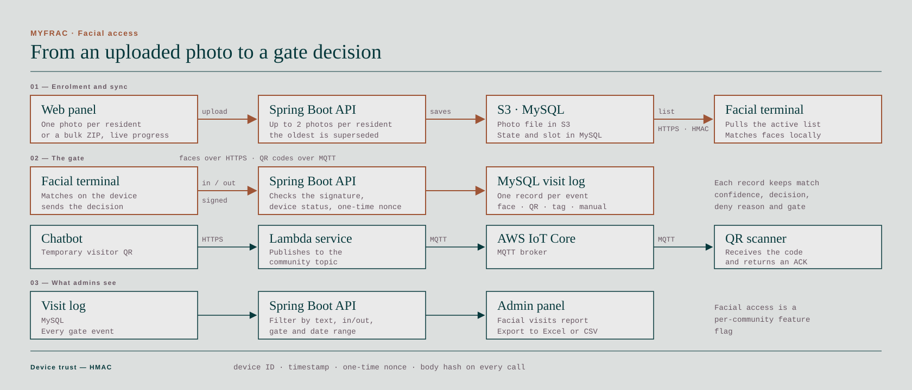

## The problem

Gated residential communities need to know who comes in, who invited them and when. Before automation, guards and residents coordinated each visitor by hand, and a single visit could take 4 to 10 minutes to process at the gate.

MYFRAC runs in 11 residential communities in Mexico and Honduras, with around 5,000 active users: residents, guards and administrators.

## What I built

I own most of the platform end to end: the infrastructure, the Java back end, the residents' and guards' mobile apps, the web admin panels and the residents' WhatsApp chatbots.

- **The core Spring Boot back end,** backed by AWS Lambda functions for asynchronous work, with CSV, Excel and PDF reports in Python and Java.
- **Access control at the gate.** Gate devices — facial recognition terminals and QR scanners — authenticate against the API with HMAC-signed HTTPS requests, and every check-in and check-out lands in a MySQL visit log. Temporary visitor QR codes reach the scanners over MQTT through AWS IoT Core.
- **The residents' WhatsApp assistant,** built on Botmaker with LLM-based language understanding (OpenAI and Anthropic). It handles about 7,000 automated visitor accesses a month and cut handling time from 4–10 minutes to 1–3, measured with operational metrics I implemented.
- **The guards' and residents' Flutter apps** for iOS and Android, and the web panels administrators use to run each community.
- **QR invitations, end to end:** the conversation flow, a new FastAPI service, changes to the Spring Boot API for compatibility, the Flutter QR-scanning app for the gate, and the AWS deployment with CDK.
- **Security for devices and people:** HMAC signatures to authenticate the IoT devices against the API, and the platform's own OAuth2 login and token flow with Spring Security.

**Facial access, end to end.** Administrators upload resident photos, one at a time or as a ZIP, and the API keeps up to two active photos per resident. Each gate terminal pulls the active list over HTTPS, matches faces on the device and reports every check-in and check-out to the API in an HMAC-signed request, which lands in a visit log administrators can filter and export. Visitor QR codes travel the other way, as MQTT messages through AWS IoT Core.

## Decisions

- **Match at the gate, record in the cloud.** Terminals match faces locally against the list they pull from the API, so recognition does not wait on a round trip. The API receives the decision and keeps the visit log.
- **A new service beside the core, not inside it.** QR invitations shipped as a FastAPI service with small changes to the Spring Boot API, so the feature moved fast without destabilising a backend that 11 communities depend on.
- **Infrastructure as code from the start.** The serverless stack (Lambda, API Gateway, IoT Core, Secrets Manager) is deployed with AWS CDK, so environments are reproducible and reviewable.
- **Measure the claim.** The time saved at the gate is backed by metrics built from system events, not by estimates.
