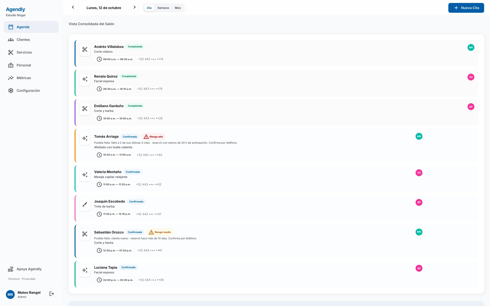
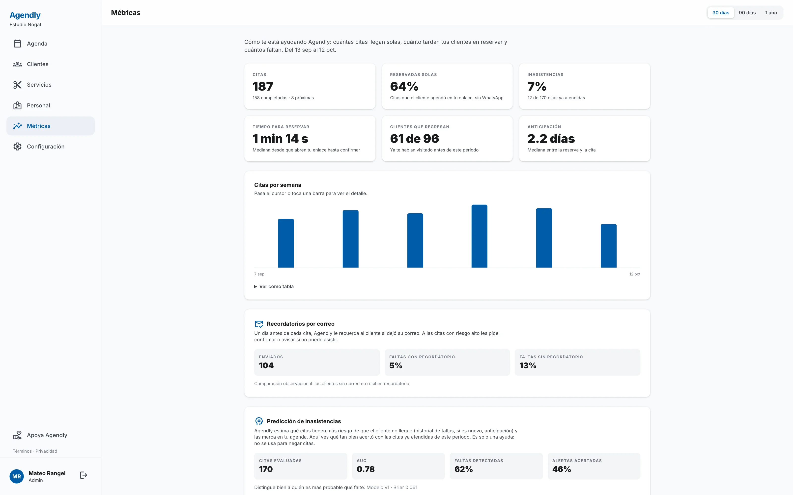

## El problema

Los salones, barberías y spas en México agendan citas a mano por WhatsApp. El dueño cambia de contexto todo el día, las reservas se pierden o se registran mal y las inasistencias llegan sin aviso. Las herramientas globales como Calendly o Acuity no encajan: están en inglés, piden al cliente final crear una cuenta y tienen precios pensados para otro mercado.

## Qué construí

Un SaaS multi-tenant con dos caras:

- **Una página pública de reservas** con una URL compartible por negocio. El cliente elige servicio, empleado y horario disponible, deja solo su nombre y teléfono, y recibe una confirmación por email. Sin crear cuenta.
- **Un panel de administración mobile-first** con vista de agenda por día y por semana, citas manuales para clientes sin reserva, y cancelación o reagendado con notificación automática al cliente.

Es un monorepo pnpm con tres paquetes: un backend en NestJS (Prisma, PostgreSQL, Passport con JWT y Google OAuth), un frontend en Nuxt 3 (Vue 3, Tailwind CSS, Pinia) y un paquete compartido de DTOs y tipos TypeScript que usan ambos. El email sale por Resend, la integración continua corre en GitHub Actions y el despliegue apunta a Railway.

## Decisiones

- **Aislamiento por tenant en el modelo de datos.** Cada tabla lleva un `tenantId`, así que cada negocio es un tenant aislado desde la primera migración.
- **Un motor de reservas agnóstico al canal.** El motor no sabe si la cita llegó por el formulario web, por captura manual o, más adelante, por WhatsApp. Los canales nuevos se conectan sin tocar las reglas de agenda.
- **Polling antes que WebSockets.** El panel se actualiza cada 10–15 segundos y solo mientras la pestaña está visible. Alcanza para el MVP y mantiene la infraestructura simple; los WebSockets están planeados para la siguiente versión.
- **Borrado lógico para empleados y servicios,** para que las citas pasadas conserven su historial cuando cambia el catálogo.
- **Contratos compartidos.** Un solo paquete de DTOs evita que la API y la interfaz se desalineen.
