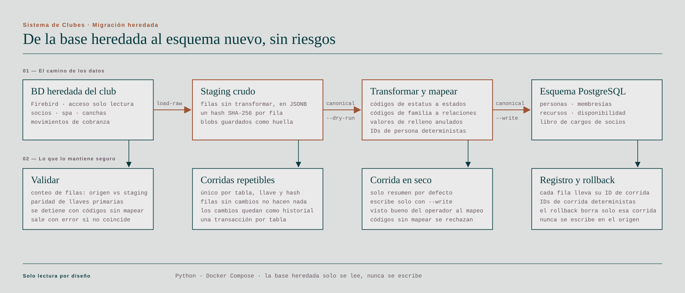

## El problema

Un club privado de golf y campo necesitaba un solo sistema para administrar sus áreas compartidas —canchas de tenis y pádel, spa, pilates— y a las muchas personas que las operan, cada una con un nivel de acceso distinto. El nombre del cliente es confidencial.

## Qué construí

- **El sistema de reservas** de áreas compartidas, con un front en React y un backend en Python/FastAPI sobre PostgreSQL.
- **Control de acceso basado en roles con permisos granulares:** superadmin, admin, supervisor y operador, además de roles de staff. La interfaz autoriza por capacidades, así cada pantalla y acción aparece solo para quien puede usarla.
- **La infraestructura en Terraform** sobre AWS, iterada con el equipo de infraestructura del cliente a partir de sus revisiones, y contenedores Docker como parte del flujo de despliegue.
- **La migración de datos desde la base heredada del club.** Un ETL en Python que lee el sistema anterior sin escribir jamás en él, guarda cada fila intacta en staging, la mapea al esquema nuevo y verifica el resultado antes de darlo por bueno.
- **Tests de la app web de reservas:** pruebas unitarias con Vitest y end-to-end con Playwright.

## Decisiones

- **Capacidades en lugar de chequeos de rol en la interfaz.** Los componentes preguntan "¿este usuario puede hacer X?" en vez de "¿este usuario es admin?". Un rol nuevo se resuelve con permisos, no con cambios de código.
- **Infraestructura revisada como código.** Escribir la infraestructura en Terraform permitió que el equipo de infra del cliente revisara cada cambio antes de que llegara a sus cuentas.
- **Migrar por etapas que se pueden repetir y deshacer.** El ETL guarda las filas heredadas crudas con un hash por fila, así que una nueva corrida omite lo que no cambió. El mapeo corre en modo de prueba por defecto, los conteos se validan contra el origen y cada escritura lleva un ID de corrida, de modo que una carga se puede revertir sin tocar el resto.
- **Tests end-to-end en el flujo de reserva,** porque una cancha reservada dos veces es el primer bug que notan los socios.
